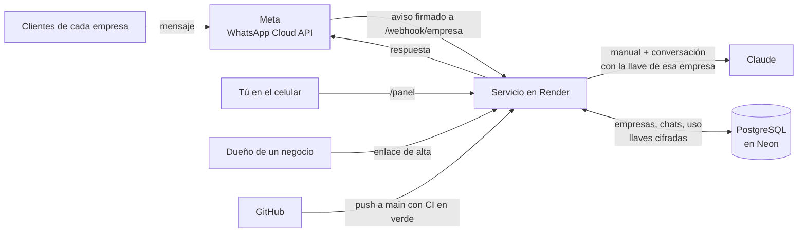
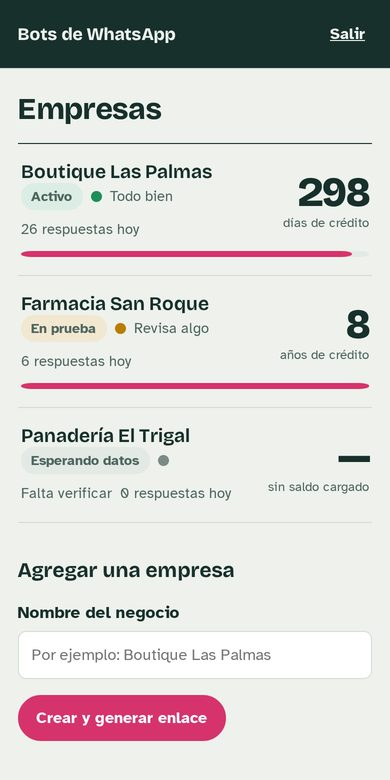
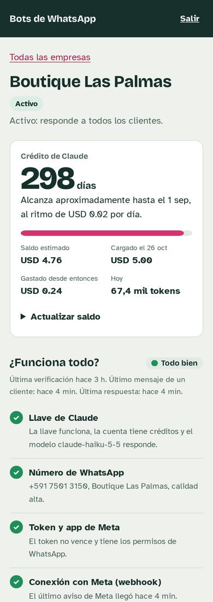
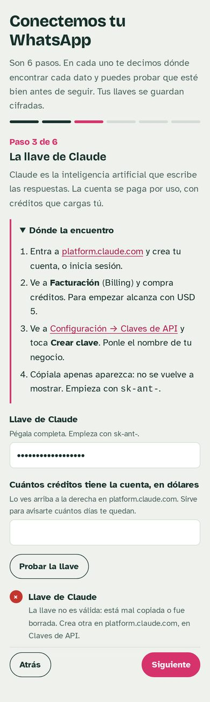

# Bots de WhatsApp con Claude — multiempresa

- Responsable: Hugo Zúñiga
- Repositorio: [hugozuniga770/Bot-WhatsApp](https://github.com/hugozuniga770/Bot-WhatsApp) · Versión: v2.5
- Tecnología: Python 3.13, Flask, API de Claude (Anthropic), WhatsApp Cloud API (Meta), PostgreSQL (Neon), Render y GitHub Actions
- Estado al 08/11/2026: v2.4 en línea en Render con el CI en verde (82 pruebas, run #6). **Prueba de punta a punta superada:** Hugo le escribió "Hola" al número de prueba de Meta y el bot de Sentirse Única le respondió. La v2.5 anota en la Actividad los mensajes que Meta no pudo entregar, con el motivo, y deja cambiar el token de verificación desde el panel; 89 pruebas en el entorno de armado. **Pendiente:** el CI de la v2.5, cargar en el panel la información del negocio (paso 2), el logo y el número real (D-05).

## 1. Qué hace

Una sola instalación atiende el WhatsApp de varias empresas. Cada empresa tiene su propia llave de Claude, su propio número de Meta y su propio manual, y sus datos no se mezclan con los de otra. Las respuestas las escribe Claude siguiendo lo que el negocio cargó. Cuando un cliente quiere comprar, reclama o pide una persona, el bot le pasa el chat al dueño y deja de responder en ese chat.

Todo se maneja desde un **panel** pensado para el celular:
- Para sumar una empresa, generas un **enlace de alta** y se lo mandas al dueño por WhatsApp.
- El dueño lo llena paso a paso. En cada paso se le explica en qué app y en qué menú está cada dato, y puede probarlo antes de seguir.
- Tú verificas y activas.
- El panel muestra si todo funciona y para cuántos días alcanza el crédito de Claude de cada empresa.

| ID | Qué hace |
|---|---|
| BOT-RF-01 | Responde los mensajes de texto con Claude, siguiendo el manual de su empresa |
| BOT-RF-02 | Recuerda la conversación: Claude recibe los últimos 20 mensajes, empezando siempre por uno del cliente |
| BOT-RF-03 | A un audio, foto o sticker le contesta con un aviso fijo, sin gastar una llamada a Claude |
| BOT-RF-04 | Pasa el chat al dueño: quita la marca `[PASAR_A_HUMANO]`, pausa ese chat 12 h y le avisa al dueño |
| BOT-RF-05 | No responde dos veces el mismo mensaje, aunque Meta lo reenvíe |
| BOT-RF-06 | Si Claude falla (sin créditos, caída), el cliente recibe una disculpa y el panel registra el error |
| BOT-RF-07 | Solo atiende avisos firmados con el App Secret de esa empresa |
| BOT-RF-08 | Verifica el webhook de cada empresa solo con su propio token, que se puede cambiar desde el panel |
| BOT-RF-09 | Ignora los avisos de enviado, entregado y leído. Si Meta avisa que no pudo entregar un mensaje, lo anota en la Actividad con el motivo |
| BOT-RF-10 | No arranca si falta una variable obligatoria, y dice cuál |
| BOT-RF-11 | Guarda todo en PostgreSQL y lo conserva aunque el servicio se reinicie |
| BOT-RF-12 | Multiempresa: cada empresa con sus llaves, su número, su manual y su webhook, sin mezclar datos |
| BOT-RF-13 | Las llaves se guardan cifradas y nunca se muestran completas |
| BOT-RF-14 | El panel pide contraseña, bloquea tras 5 intentos fallidos y protege sus formularios (CSRF) |
| BOT-RF-15 | Alta por enlace: sirve una sola vez, vence en 7 días y explica cada dato mal escrito |
| BOT-RF-16 | Verifica de verdad la llave de Claude (y el crédito), el número, el token, la app de Meta y el webhook; manda un mensaje de prueba; no deja activar si algo falla |
| BOT-RF-17 | Cuenta los tokens por día y estima el saldo y para cuántos días alcanza |
| BOT-RF-18 | En prueba, el bot solo le responde al dueño; pausado o sin datos, a nadie |
| BOT-RF-19 | No responde a los números de la lista de ignorados (familia, proveedores) |
| BOT-RF-20 | Cada empresa tiene su página pública de privacidad y de borrado de datos (las pide Meta). Un cliente que pide borrar sus datos se deriva al dueño, y desde el panel se borra su conversación |

## 2. Cómo funciona



- **GitHub** guarda el código y corre las pruebas en cada push. No puede tener el bot prendido: un workflow de Actions dura minutos y no tiene una dirección pública.
- **Render** corre el servicio 24/7 y se actualiza solo con cada push a `main` que pase el CI.
- **Neon (PostgreSQL)** guarda las empresas, las conversaciones, el uso y las llaves, cifradas con la `CLAVE_MAESTRA`.
- **Render solo necesita 3 variables** (`DATABASE_URL`, `ADMIN_PASSWORD`, `CLAVE_MAESTRA`). Las llaves de cada empresa se cargan desde el panel.

Detalle en [docs/arquitectura.md](docs/arquitectura.md).

## 3. Cómo se usa

| Empresas | Detalle de una empresa | Enlace de alta (paso 3) |
|---|---|---|
|  |  |  |

1. **Agregar:** en el panel escribes el nombre del negocio y tocas **Crear y generar enlace**. Aparece el enlace con un botón **Enviar por WhatsApp**.
2. **Alta:** el dueño abre el enlace y sigue 6 pasos: su negocio, lo que el bot debe saber, la llave de Claude, los datos de Meta, conectar el webhook y enviar. Cada paso dice dónde está cada dato, y los botones **Probar** lo comprueban en el momento. El paso del webhook cambia solo a **Conectado** cuando Meta lo verifica. Si prefieres, lo llenas tú desde **Editar datos y llaves**.
3. **Prueba:** al enviar, la empresa queda **En prueba** y el bot solo le responde al dueño, que le escribe al número del negocio desde su celular personal.
4. **Publicar la app en Meta** (una vez por app): en Configuración de la app → Básica pones el ícono, la categoría y las dos direcciones que muestra el panel en **Conexión** (privacidad y borrado de datos). Después la publicas. Sin esto, Meta no le entrega al bot los mensajes reales.
5. **Verificar y activar:** tocas **Verificar todo** y **Enviar mensaje de prueba**, y luego **Activar para todos**. Si algo falla, el panel no deja activar y explica qué arreglar. Si Meta acepta un mensaje pero no lo puede entregar (por ejemplo, por la regla de las 24 horas), el motivo aparece en **Actividad**.
6. **Día a día:** la lista muestra cuántos días de crédito quedan por empresa. Cuando cargues más créditos en platform.claude.com, actualiza el saldo en el panel.

## 4. Requisitos

- **Python 3.13** (la del CI). También se probó con 3.12.
- Las dependencias de [requirements.txt](requirements.txt), con versiones exactas. `tzdata` hace falta en Windows para la zona horaria de Bolivia.
- Cuentas tuyas: GitHub, Render y Neon.
- Cada empresa trae las suyas: Anthropic (platform.claude.com, con créditos) y una app de Meta con WhatsApp.

## 5. Cómo ponerlo a andar en tu PC (Windows, PowerShell)

```powershell
cd $env:USERPROFILE\Downloads\Bot-WhatsApp
python -m venv .venv
.\.venv\Scripts\Activate.ps1
pip install -r requirements.txt
Copy-Item .env.example .env
python -m bot
```

En el `.env` basta con `ADMIN_PASSWORD` y `CLAVE_MAESTRA`. Sin `DATABASE_URL`, todo vive en memoria y se borra al cerrar, lo que sirve para mirar el panel. Abre `http://localhost:5000/` y entra con tu contraseña. Si PowerShell bloquea `Activate.ps1`, corre antes `Set-ExecutionPolicy -Scope Process -ExecutionPolicy Bypass`.

Para que Meta llegue a tu PC mientras pruebas: `cloudflared tunnel --url http://localhost:5000`, y pon en `URL_PUBLICA` la dirección que te da.

## 6. Cómo correr las pruebas

```powershell
python -m pytest -v
```

- **En tu PC:** 78 passed y 11 skipped. Los saltados son los de PostgreSQL, que necesitan una base de prueba.
- **En el CI:** GitHub levanta un PostgreSQL temporal y corren las 89. El CI falla si alguna se salta.

Ninguna prueba usa la red: Meta, Claude y las verificaciones se reemplazan por dobles. [docs/pruebas.md](docs/pruebas.md) relaciona cada test con su requisito.

## 7. Cómo se despliega

1. Aplicas el parche y haces push: el CI corre las pruebas.
2. En Neon creas una base y copias su cadena de conexión.
3. En Render: **New → Blueprint** con este repositorio, y pegas `DATABASE_URL` y `ADMIN_PASSWORD`. La `CLAVE_MAESTRA` la genera Render.
4. Entras a `https://<tu-servicio>.onrender.com/` y agregas la primera empresa.

Paso a paso, con una comprobación después de cada paso y los problemas frecuentes: [docs/despliegue.md](docs/despliegue.md).

## 8. Estructura del proyecto

```
bot/
  app.py            armado de la app y webhook de cada empresa (/webhook/<slug>)
  panel.py          panel del administrador (/panel)
  alta.py           enlace de alta (/alta/<token>)
  servicios.py      atención de un mensaje de principio a fin
  reglas.py         todas las reglas; funciones puras, sin red ni base
  almacen.py        empresas, chats, uso y eventos (memoria o PostgreSQL)
  empresas.py       formularios, llaves cifradas y enlaces
  verificaciones.py pruebas reales contra Claude y Meta
  tablero.py        resumen de cada empresa para el panel
  manual.py         arma el manual de cada empresa
  cifrado.py        cifrado de llaves con la CLAVE_MAESTRA
  seguridad.py      contraseña, sesión, CSRF y límite de intentos
  whatsapp.py       envío y consultas a la Cloud API de Meta
  asistente.py      llamada a Claude (cuenta los tokens)
  config.py         variables de entorno
  formato.py        dinero, fechas y tiempos en las pantallas
  templates/        pantallas (Jinja)
  static/           estilos y JavaScript
tests/              89 tests y conftest.py con los dobles
docs/               arquitectura, despliegue, decisiones, pruebas, cambios, glosario y capturas
instrucciones.md    plantilla común del manual (vale para todas las empresas)
render.yaml         cómo Render crea y arranca el servicio
.python-version     versión de Python que usa Render (3.13, la misma del CI)
.github/workflows/ci.yml   pruebas en cada push, con PostgreSQL real
```

**Regla de arquitectura:**

- **Las rutas solo reciben:** `app.py`, `panel.py` y `alta.py` comprueban firma, sesión y CSRF, y llaman a `servicios`, `empresas` o `verificaciones`. No deciden reglas.
- **`reglas.py` es el único lugar de las reglas:** firma, recorte, pausa, estimación de crédito y formatos. Recibe datos ya leídos y no toca la red ni la base.
- **`ahora` es un parámetro** de todo lo que depende del tiempo: la app pasa la hora real y los tests, la suya.
- **Lo externo entra por parámetros:** almacén, clientes de Meta y de Claude, verificador y reloj. Así los tests usan dobles.
- **Las llaves solo existen descifradas en memoria,** en el momento de usarlas.

## 9. Lo que no se hizo o queda provisional

- **El número de tu mamá: pendiente** (D-05). Hoy cada empresa conecta un número de Meta. Para el número que ya usa la app de WhatsApp Business falta decidir entre un proveedor con coexistencia o un número aparte.
- **Saldo estimado, no leído** (D-15). Anthropic no deja leer el saldo por API en cuentas individuales. El panel cuenta los tokens y resta del saldo que cargaste; actualízalo cuando recargues.
- **Solo texto** (D-08): audios, fotos y stickers reciben un aviso fijo.
- **Las respuestas que el dueño escribe desde su celular no entran al historial.** Depende de la coexistencia (D-05).
- **Aviso al dueño [PROVISIONAL]:** WhatsApp solo deja mandar mensajes libres a quien escribió al negocio en las últimas 24 h. Si no, el aviso falla y el motivo queda en Actividad. Para que siempre llegue haría falta una plantilla aprobada por Meta.
- **El token de verificación queda en los registros de Render** (D-24): Meta lo manda dentro de la dirección. Solo sirve para verificar el webhook, no para mandar ni leer mensajes. Cámbialo desde el panel después de conectar.
- **Render gratis se duerme** tras 15 min sin tráfico: el primer mensaje después tarda alrededor de un minuto (D-02).
- **Un solo administrador** (D-20): una contraseña, sin usuarios ni permisos por empresa.
- **Decisiones y cambios:** [docs/decisiones.md](docs/decisiones.md) y [docs/cambios.md](docs/cambios.md).

## 10. Declaración de uso de IA

Punto de partida verificable: el código, las pruebas, el diseño y esta documentación los propuso Claude (Anthropic), en claude.ai, entre el 07/11/2026 y el 08/11/2026. Lo que tú revises, cambies, pruebes y subas lo cuentas en tu párrafo, solo con lo que es cierto. Guía de qué contar:

- **Qué herramienta** usaste (nombre y, si lo sabes, el modelo).
- **Para qué parte**: código, tests, documentación, despliegue o revisión.
- **Qué hizo la IA y qué hiciste tú**: si la IA explicó, propuso o revisó, y si tú lo escribiste, lo adaptaste, lo probaste o lo subiste.
- **Que revisaste y puedes explicar** lo que lleva tu nombre.

**Hugo Zúñiga:** *(pendiente: lo escribes tú)*
