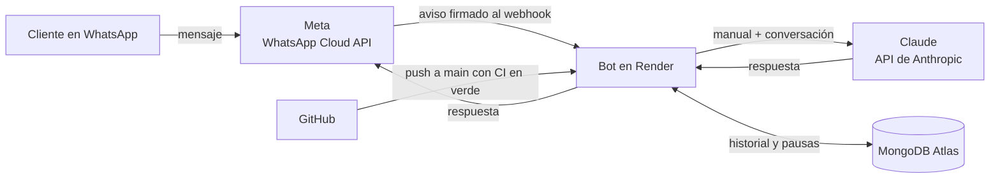

# Bot de WhatsApp con Claude — negocio de mi mamá

- Responsable: Hugo Zúñiga
- Repositorio: [hugozuniga770/Bot-WhatsApp](https://github.com/hugozuniga770/Bot-WhatsApp) · Versión: v1.0
- Para: [NOMBRE DEL NEGOCIO], de [NOMBRE DE LA DUEÑA]
- Tecnología: Python 3.13, Flask, API de Claude (Anthropic), WhatsApp Cloud API (Meta), MongoDB Atlas, Render y GitHub Actions
- Estado al 07/11/2026: código listo y 17 pruebas en verde en el entorno donde se armó el proyecto. **Pendiente:** la corrida en tu PC y en GitHub Actions, el despliegue ([docs/despliegue.md](docs/despliegue.md)) y el manual con los datos reales del negocio.

## 1. Qué hace

Responde de día y de noche los mensajes de WhatsApp que los clientes le mandan al negocio. Las respuestas las escribe Claude siguiendo un manual, [instrucciones.md](instrucciones.md), con la información del negocio. Cuando un cliente quiere comprar, reclama o pide hablar con una persona, el bot le pasa la conversación a la dueña y deja de responder en ese chat.

| ID | Qué hace |
|---|---|
| BOT-RF-01 | Responde los mensajes de texto con Claude, siguiendo `instrucciones.md` |
| BOT-RF-02 | Recuerda la conversación: Claude recibe los últimos 20 mensajes, empezando siempre por uno del cliente |
| BOT-RF-03 | A un audio, foto o sticker le contesta con un aviso fijo, sin gastar una llamada a Claude |
| BOT-RF-04 | Pasa el chat a la dueña: quita la marca `[PASAR_A_HUMANO]`, pausa ese chat 12 h y le avisa a la dueña |
| BOT-RF-05 | No responde dos veces el mismo mensaje, aunque Meta lo reenvíe |
| BOT-RF-06 | Si Claude falla (sin créditos, caída), el cliente recibe una disculpa en vez de silencio |
| BOT-RF-07 | Solo atiende avisos firmados por Meta (App Secret) |
| BOT-RF-08 | Responde la verificación del webhook solo con la palabra secreta correcta |
| BOT-RF-09 | Ignora los avisos de estado (enviado, entregado, leído) |
| BOT-RF-10 | No arranca si falta una variable obligatoria, y dice cuál |

## 2. Cómo funciona



- **GitHub** guarda el código y corre las pruebas en cada push. No puede tener el bot prendido: un workflow de Actions dura minutos y no tiene una dirección pública a la que Meta pueda llamar.
- **Render** es la máquina que corre el bot 24/7. Toma el código de GitHub y, cada vez que haces push a `main` y el CI pasa en verde, se actualiza solo.
- **MongoDB Atlas** guarda la memoria (conversaciones y pausas). Hace falta porque Render gratis borra todo lo local cuando se reinicia o se duerme.

El detalle (componentes, recorrido de un mensaje, datos guardados y variables) está en [docs/arquitectura.md](docs/arquitectura.md).

## 3. Requisitos

- **Python 3.13** (la del CI). También se probó con 3.12.
- Las dependencias de [requirements.txt](requirements.txt): anthropic 2.6.0, Flask 3.1.3, gunicorn 26.2.0, pymongo 4.19.0, pytest 9.2.0, python-dotenv 1.2.4 y requests 2.34.2.
- Cuentas: Anthropic ([platform.claude.com](https://platform.claude.com), con créditos), Meta for Developers, GitHub, Render y MongoDB Atlas. Para probar en tu PC, MongoDB es opcional.
- Para probar en tu PC: [cloudflared](https://developers.cloudflare.com/cloudflare-one/connections/connect-networks/downloads/), que le da a tu PC una dirección pública temporal.

## 4. Cómo ponerlo a andar en tu PC (Windows, PowerShell)

Desde la carpeta del proyecto:

```powershell
python -m venv .venv
.\.venv\Scripts\Activate.ps1
pip install -r requirements.txt
Copy-Item .env.example .env
python -m bot
```

| Paso | Qué hace |
|---|---|
| `python -m venv .venv` y `Activate.ps1` | Crea y activa el entorno virtual. Si PowerShell bloquea el script, antes: `Set-ExecutionPolicy -Scope Process -ExecutionPolicy Bypass`. |
| `pip install -r requirements.txt` | Instala las versiones exactas. gunicorn se instala pero no corre en Windows: solo lo usa Render. |
| `Copy-Item .env.example .env` | Crea tu `.env`. Lo llenas con tus llaves; cada variable está explicada en el archivo. |
| `python -m bot` | Arranca el bot en `http://localhost:5000/`. Si falta una variable, se detiene y dice cuál (BOT-RF-10). |

**Comprobación:** `http://localhost:5000/` debe mostrar `ok`.

Para que Meta llegue a tu PC, en otra terminal:

```powershell
cloudflared tunnel --url http://localhost:5000
```

Te da una URL `https://algo.trycloudflare.com`. En Meta, el webhook es esa URL más `/webhook`. **La URL cambia cada vez que reinicias cloudflared**, por eso el bot de verdad vive en Render.

## 5. Cómo correr las pruebas

```powershell
python -m pytest -v
```

Son **17 tests**, nombrados por requisito (`test_RF04_...`). No necesitan llaves ni internet: WhatsApp y Claude se reemplazan por dobles que anotan lo que reciben, y el almacén es el de memoria. [docs/pruebas.md](docs/pruebas.md) relaciona cada test con su requisito, dice su estado y declara lo que no se prueba.

## 6. Cómo se despliega (GitHub → Render)

1. Subes el proyecto a [hugozuniga770/Bot-WhatsApp](https://github.com/hugozuniga770/Bot-WhatsApp). El `.env` nunca se sube.
2. En Render: **New → Blueprint**, eliges el repositorio y llenas las variables. Render lee [render.yaml](render.yaml) y crea el servicio.
3. En Meta pones el webhook `https://<tu-servicio>.onrender.com/webhook`.

Desde ahí, **cada push a `main` con el CI en verde se despliega solo** (D-09). El paso a paso, con una comprobación después de cada paso y una tabla de problemas frecuentes, está en [docs/despliegue.md](docs/despliegue.md).

## 7. Cómo cambiar lo que sabe el bot

Todo lo que el bot sabe y cómo habla está en [instrucciones.md](instrucciones.md). Para cambiarlo no se toca código: editas ese archivo, haces commit y push, y Render se actualiza en unos minutos. Dos cuidados: el bot solo sabe lo que está escrito ahí, y la sección final con la marca `[PASAR_A_HUMANO]` debe quedarse tal cual, porque de ella depende la derivación (BOT-RF-04).

## 8. Estructura del proyecto

```
bot/
  app.py           recepción: rutas que llama Meta; comprueba la firma y llama a servicios
  servicios.py     atención de un mensaje de principio a fin
  reglas.py        todas las reglas; funciones puras, sin red ni base
  almacen.py       historial, pausas y mensajes atendidos (memoria o MongoDB)
  whatsapp.py      envío de mensajes por la Cloud API de Meta
  asistente.py     llamada a la API de Claude
  config.py        lee y valida las variables de entorno
  __main__.py      arranque en tu PC (python -m bot)
tests/             los 17 tests y conftest.py con los dobles
docs/              arquitectura, despliegue, decisiones, pruebas, cambios y glosario
instrucciones.md   el manual del bot (lo que sabe y cómo habla)
render.yaml        cómo Render crea y arranca el servicio
.github/workflows/ci.yml   pruebas en cada push
.env.example       plantilla de variables (el .env real no se sube)
```

**Regla de arquitectura:**

- **`app.py` solo recibe:** comprueba la firma y le pasa cada mensaje a `servicios`. No decide nada.
- **`servicios.py` coordina:** lee y guarda con el almacén, le pregunta a `reglas` y habla con WhatsApp y con Claude.
- **`reglas.py` es el único lugar de las reglas:** recibe datos ya leídos, no toca la red ni la base.
- **`ahora` es un parámetro** de todo lo que depende del tiempo (pausas, ids atendidos): la ruta pasa la hora real y los tests, la suya.
- **Lo externo entra por el constructor:** `Servicios` recibe el almacén, WhatsApp y el asistente, así los tests usan dobles sin tocar Meta ni Claude.

## 9. Lo que no se hizo o queda provisional

- **El número de tu mamá: pendiente** (D-05). Hoy el bot funciona con el número de prueba de Meta. Falta decidir entre un proveedor con coexistencia o un número aparte.
- **Solo texto** (D-08): audios, fotos y stickers reciben un aviso fijo.
- **Las respuestas que la dueña escribe desde su celular no entran al historial.** Depende de la coexistencia (D-05).
- **Aviso a la dueña [PROVISIONAL]:** WhatsApp solo deja mandar un mensaje libre a un número que le escribió al negocio en las últimas 24 h. Si no, el aviso falla y queda en el log. La solución definitiva es una plantilla aprobada por Meta (pendiente).
- **Render gratis se duerme** tras 15 min sin mensajes. El primer mensaje después tarda alrededor de un minuto (D-02).
- **Durante una pausa, los mensajes del cliente no se guardan** (D-10).
- **`AlmacenMongo` no tiene test automático:** se comprueba a mano en el paso 6 del despliegue ([docs/pruebas.md](docs/pruebas.md)).
- **El token de prueba de Meta vence en unas 24 h:** el permanente se saca en el paso 7 del despliegue.
- **El manual tiene espacios `[completar]`** hasta tener los datos del negocio.
- **Decisiones y cambios:** [docs/decisiones.md](docs/decisiones.md) y [docs/cambios.md](docs/cambios.md).

## 10. Declaración de uso de IA

Punto de partida verificable: el código, las pruebas y esta documentación los propuso Claude (Anthropic), en claude.ai, el 07/11/2026. Lo que tú revises, cambies, pruebes y subas lo cuentas en tu párrafo, solo con lo que es cierto. Guía de qué contar:

- **Qué herramienta** usaste (nombre y, si lo sabes, el modelo).
- **Para qué parte**: código, tests, documentación, despliegue o revisión.
- **Qué hizo la IA y qué hiciste tú**: si la IA explicó, propuso o revisó, y si tú lo escribiste, lo adaptaste, lo probaste o lo subiste.
- **Que revisaste y puedes explicar** lo que lleva tu nombre.

**Hugo Zúñiga:** *(pendiente: lo escribes tú)*
