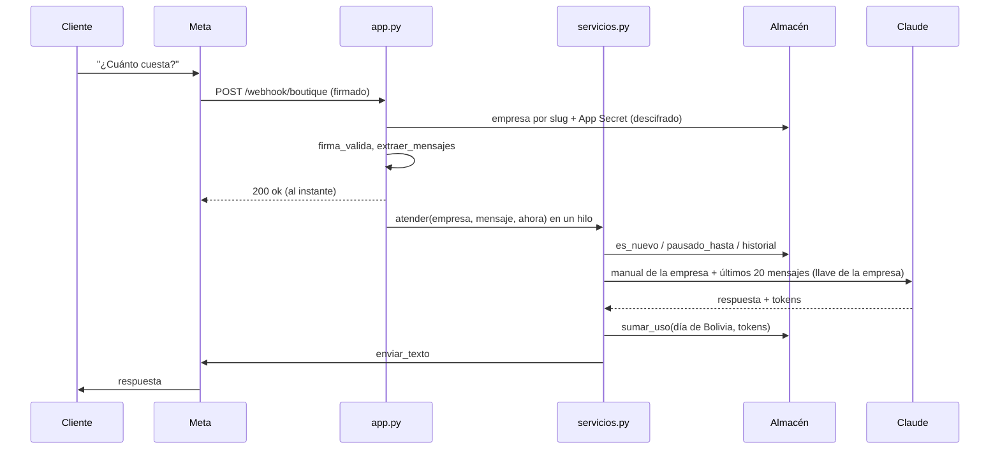
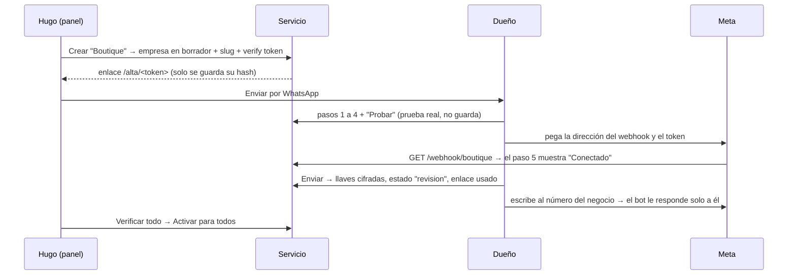

# Arquitectura

- Proyecto: Bots de WhatsApp con Claude · Responsable: Hugo Zúñiga
- Fecha: 08/11/2026 · Versión: v2.0
- Relacionados: [README](../README.md) · [Despliegue](despliegue.md) · [Decisiones](decisiones.md) · [Pruebas](pruebas.md)

## 1. Componentes

| Componente | Archivo | Responsabilidad |
|---|---|---|
| Webhook | `bot/app.py` | `GET/POST /webhook/<slug>`: verifica el token y la firma de **esa** empresa, responde 200 y atiende en un hilo |
| Panel | `bot/panel.py` | `/panel`: lista, detalle, verificar, prueba, estado, saldo, editar, enlaces |
| Alta | `bot/alta.py` | `/alta/<token>`: formulario de 6 pasos, pruebas en vivo, estado del webhook |
| Atención | `bot/servicios.py` | Un mensaje de principio a fin: estado → duplicado → ignorado → modo prueba → pausa → Claude → envío → derivación → uso |
| Reglas | `bot/reglas.py` | Funciones puras: firma, mensajes, recorte, pausa, formatos, crédito, serie diaria |
| Datos | `bot/almacen.py` | Empresas, enlaces, chats, pausas, uso, actividad y eventos (memoria o PostgreSQL) |
| Empresas | `bot/empresas.py` | Leer formularios, cifrar llaves, crear y buscar enlaces |
| Verificaciones | `bot/verificaciones.py` | Pruebas reales: Claude (llave, modelo, crédito), número y calidad, token, App ID y App Secret, webhook |
| Tablero | `bot/tablero.py` | Resumen de una empresa: salud, crédito, serie de 14 días, actividad |
| Manual | `bot/manual.py` | Plantilla común (`instrucciones.md`) + datos de la empresa |
| Seguridad | `bot/seguridad.py`, `bot/cifrado.py` | Contraseña, sesión, CSRF, límite de intentos; cifrado Fernet con la `CLAVE_MAESTRA` |
| Salidas | `bot/whatsapp.py`, `bot/asistente.py` | Graph API de Meta; API de Claude (devuelve texto y tokens) |

## 2. Recorrido de un mensaje

Antes de llamar a Claude, `atender` corta en este orden:
1. Empresa pausada o sin datos: no responde.
2. Mensaje repetido: no responde.
3. Número ignorado: no responde.
4. Empresa en prueba y el que escribe no es el dueño: no responde.
5. Chat en pausa: no responde.
6. Audio, foto o sticker: manda el aviso fijo.

## 3. Alta de una empresa

## 4. Datos (PostgreSQL)

Las tablas se crean solas al arrancar. Si la base tiene tablas de la v1.x, el servicio se detiene con un mensaje claro en vez de mezclarlas.

| Tabla | Una fila por | Lo importante |
|---|---|---|
| `empresas` | Empresa | `slug` único, `estado`, y `datos` (JSON): dueño, info del negocio, ajustes, saldo, última verificación y llaves cifradas (`*_cif`) |
| `invitaciones` | Enlace de alta | Solo el **hash** del token, `vence`, `usada` |
| `mensajes` | Mensaje de un chat | `empresa_id`, `numero`, `rol`, `texto`, `fecha` |
| `pausas` | Chat derivado | `(empresa_id, numero)`, `hasta` |
| `mensajes_atendidos` | Id de Meta procesado | `(empresa_id, id)`; los de más de 7 días se borran al arrancar |
| `uso` | Empresa y día | `llamadas`, `entrada`, `salida` (tokens); el día es el de Bolivia |
| `actividad` | Empresa y tipo | Última vez de `webhook`, `mensaje` y `respuesta` |
| `eventos` | Algo que pasó | Errores, derivaciones, verificaciones, cambios de estado; se borran a los 60 días |

## 5. Seguridad

- **Llaves cifradas (BOT-RF-13):** Fernet, con una clave derivada de `CLAVE_MAESTRA`. En la base y en el panel nunca aparecen completas (`sk-ant-…1234`).
- **Webhook por empresa (BOT-RF-07, 08):** cada empresa tiene su `verify_token` y su App Secret. Un aviso firmado para una empresa no sirve para otra.
- **Panel (BOT-RF-14):**
  - una contraseña (`ADMIN_PASSWORD`);
  - sesión de 30 días con cookie `HttpOnly`, `SameSite=Lax` y `Secure` en Render;
  - token CSRF en cada formulario;
  - 5 intentos fallidos bloquean esa IP 15 minutos.
- **Enlaces de alta (BOT-RF-15):** 32 bytes al azar; en la base solo queda el hash. Sirven una vez y vencen en 7 días.
- **Cabeceras:**
  - `Content-Security-Policy`: sin scripts ni estilos en línea; solo los propios y Google Fonts;
  - `X-Frame-Options: DENY`;
  - `Referrer-Policy: no-referrer`, para que el token del enlace no se filtre al abrir las guías de Meta o Claude;
  - `Cache-Control: no-store` en el panel y en el alta.
- **Logs:** los números de clientes salen recortados (`...1234`).

## 6. Variables de entorno

| Variable | Obligatoria | Para qué |
|---|---|---|
| `ADMIN_PASSWORD` | Sí | Contraseña del panel (mínimo 10 caracteres) |
| `CLAVE_MAESTRA` | Sí | Cifra las llaves de las empresas. En Render se genera sola. **Si cambia, hay que volver a cargar las llaves** |
| `DATABASE_URL` | En Render, sí | PostgreSQL de Neon. Sin ella, todo en memoria |
| `URL_PUBLICA` | No | Dirección pública; en Render se toma de `RENDER_EXTERNAL_URL` |
| `SECRET_KEY` | No | Firma de la sesión; si falta, se deriva de la `CLAVE_MAESTRA` |
| `ZONA_HORARIA` | No (`America/La_Paz`) | Día con el que se cuenta el uso |
| `GRAPH_VERSION` | No (`v23.0`) | Versión de la API de Meta |
| `INSTRUCCIONES_ARCHIVO` | No | Otra plantilla de manual en vez de `instrucciones.md` |

Por empresa, desde el panel: modelo (por defecto `claude-haiku-5-5`), precios por millón de tokens (0.10 y 0.50 USD, de la página oficial de precios, consultada el 07/11/2026), horas de pausa, mensajes de historial, números ignorados e indicaciones adicionales.
