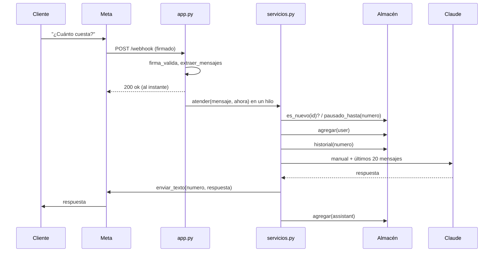

# Arquitectura

- Proyecto: Bot de WhatsApp con Claude (negocio de mi mamá) · Responsable: Hugo Zúñiga
- Fecha: 07/11/2026 · Estado: código listo; despliegue **pendiente**
- Relacionados: [README](../README.md) · [Despliegue](despliegue.md) · [Decisiones](decisiones.md) · [Pruebas](pruebas.md)

## 1. Componentes

| Componente | Archivo | Responsabilidad | Usa |
|---|---|---|---|
| Recepción | `bot/app.py` | Rutas `GET /`, `GET /webhook` (verificación) y `POST /webhook` (mensajes). Comprueba la firma y entrega cada mensaje a `servicios` en un hilo | `reglas.firma_valida`, `reglas.extraer_mensajes`, `Servicios.atender` |
| Orquestación | `bot/servicios.py` | Atiende un mensaje: duplicado → pausa → tipo → Claude → envío → derivación | Almacén, WhatsApp, Asistente, `reglas` |
| Reglas | `bot/reglas.py` | Decide: firma, qué es un mensaje, recorte del historial, marca de derivación, pausa | Nada: funciones puras |
| Datos | `bot/almacen.py` | Guarda historial, pausas e ids atendidos | MongoDB (o memoria) |
| Salida a WhatsApp | `bot/whatsapp.py` | `POST /{PHONE_NUMBER_ID}/messages` en la Graph API de Meta | requests |
| Salida a Claude | `bot/asistente.py` | `messages.create` con el manual como instrucciones del sistema | SDK `anthropic` |
| Configuración | `bot/config.py` | Lee y valida variables; carga `instrucciones.md` | Entorno |

## 2. Recorrido de un mensaje

Si Claude termina su respuesta con `[PASAR_A_HUMANO]`, `servicios` envía el texto sin la marca, guarda `pausado_hasta = ahora + 12 h` y, si hay `DUENA_NUMERO`, le manda el aviso. Mientras dura la pausa, `atender` devuelve `pausado` sin responder ni llamar a Claude.

## 3. Por qué responde 200 antes de pensar (D-07)

Claude tarda unos segundos en responder. Si el webhook esperara ese tiempo, Meta podría dar el aviso por fallido y reenviarlo. Por eso `app.py` contesta `200` al instante y atiende en un hilo. Si igual llega un reenvío, `es_nuevo(id)` lo frena (BOT-RF-05). Esto exige **un solo proceso con varios hilos** (`--workers 1 --threads 4` en `render.yaml`): los candados por cliente viven en memoria del proceso.

## 4. Datos que se guardan

| Colección (MongoDB) | Un documento por | Campos | Cuánto dura |
|---|---|---|---|
| `conversaciones` | Cliente (`_id` = número) | `mensajes` (rol, texto, fecha; últimos 100), `pausado_hasta`, `actualizado` | Hasta que se borre a mano |
| `mensajes_atendidos` | Mensaje de Meta (`_id` = id) | `creado` | 7 días (índice TTL) |

En GitHub no se guarda ningún dato de clientes ni ninguna llave. En los logs de Render, los números salen recortados a los últimos 4 dígitos (`...1234`).

## 5. Variables de entorno

| Variable | Obligatoria | Para qué | Dónde se saca |
|---|---|---|---|
| `ANTHROPIC_API_KEY` | Sí | Llamar a Claude | platform.claude.com → API keys |
| `WHATSAPP_TOKEN` | Sí | Enviar mensajes | Meta → WhatsApp → API Setup (temporal) o usuario del sistema (permanente) |
| `PHONE_NUMBER_ID` | Sí | Desde qué número se envía | Meta → WhatsApp → API Setup |
| `APP_SECRET` | Sí | Comprobar la firma de Meta | Meta → App settings → Basic |
| `VERIFY_TOKEN` | Sí | Verificar el webhook | La inventas tú |
| `MONGODB_URI` | En Render, sí | Guardar historial y pausas | MongoDB Atlas → Connect → Drivers |
| `DUENA_NUMERO` | No | A quién avisar al derivar | Número con código de país, sin `+` |
| `PAUSA_HORAS` | No (12) | Duración de la pausa | — |
| `HISTORY_LIMIT` | No (20) | Mensajes que recibe Claude | — |
| `MAX_TOKENS` | No (600) | Largo máximo de cada respuesta | — |
| `CLAUDE_MODEL` | No (`claude-haiku-5-5`) | Modelo de Claude | Docs de Anthropic |
| `GRAPH_VERSION` | No (`v23.0`) | Versión de la API de Meta | Ejemplos del panel de Meta |
| `MONGODB_BASE` | No (`bot_whatsapp`) | Nombre de la base | — |
| `INSTRUCCIONES_ARCHIVO` | No | Otro manual en vez de `instrucciones.md` | — |
